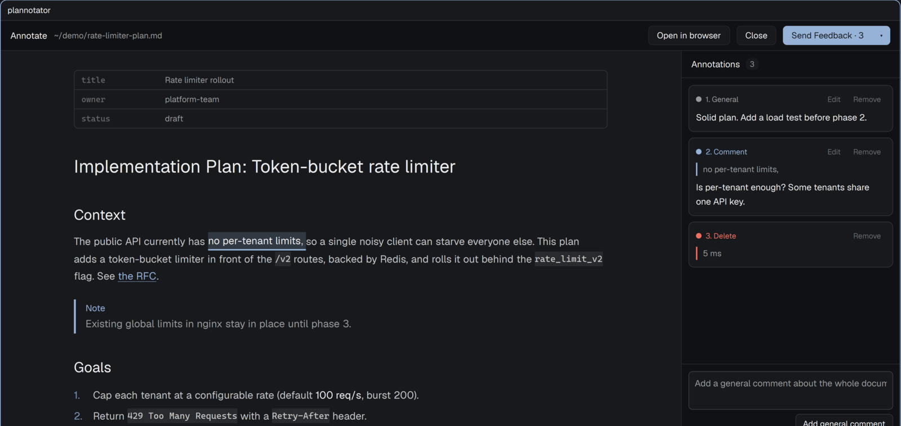

# herdr-plannotator

Review Plannotator sessions in a herdr-app pane instead of a browser tab.



Plannotator runs as usual: same CLI, same local server, same output for the
agent. Only the review surface changes. The session opens as a native pane
beside the agent's terminal, and your decision goes back over the same HTTP
API the web page uses.

## Install

Needs herdr-app, [Plannotator](https://github.com/backnotprop/plannotator) and `jq`.

```sh
git clone https://github.com/iuliansafta/herdr-plannotator
cd herdr-plannotator && ./install.sh
```

This links three things to this checkout:

- `mods/plannotator/` as the herdr mod `plannotator` (`~/.config/herdr-app/mods/plannotator`)
- `bin/plannotator-herdr` into `~/.local/bin`
- `skill/plannotator-herdr` into `~/.claude/skills`, so agents know the command

## Use

Ask the agent to open something "in herdr", or run it yourself:

```sh
plannotator-herdr annotate plan.md     # same arguments as plannotator
plannotator-herdr review
plannotator-herdr annotate-last
```

To send every Plannotator session to herdr, plan review from the
ExitPlanMode hook included, set the browser for the agent's environment:

```sh
export PLANNOTATOR_BROWSER=~/.local/bin/plannotator-herdr
```

With no herdr window, the launcher falls back to the browser. Set
`PLANNOTATOR_HERDR_PLACE` to `down` or `tab` to open the pane there instead
of on the right.

## What is native

| Session | In the pane |
| --- | --- |
| Plan review (ExitPlanMode hook) | rendered plan; select text to comment or delete; general comments; Approve / Send Feedback / the web's menu (note, discard) |
| `annotate` a Markdown file, `annotate-last` | the same document view; Send Feedback, Close, Approve with `--gate` |
| `review` (local diff or PR) | file list with viewed state, unified diff, line, file and general comments, diff-type switch; Approve / Send Feedback / Close |

Each pane has **Open in browser**, which opens the same session in the web UI
for the rest: Ask AI, tours and guided reviews, image attachments, linked
documents, plan version diffs, folders and bundles, raw HTML and live-app
annotation, PR platform actions, sharing, and settings.

## How it stays compatible

- The request bodies, the feedback markdown and the decision menu come from
  Plannotator's own code, bundled from the tag of the installed CLI
  (`mods/plannotator/vendor/plannotator.js`, `PINNED_VERSION`).
- Plannotator updates itself. After an update, the pane header shows
  "Plannotator X · pane built for Y" until you run `tools/update-vendor.sh`.
- Settings the browser keeps in cookies use the web's first-run defaults:
  plan approval sends `permissionMode: acceptEdits` and saves the plan.
  `agentSwitch` and your display name follow Plannotator's `config.json`.

## Develop

Read `DESIGN.md` first.

```sh
bun test                      # builders, document model, diff parser
bun tests/e2e.ts              # builders against the installed CLI
tests/pane-e2e.sh             # the pane itself, on a hidden herdr screen
herdr-app check mods/plannotator   # after every mod change
```
