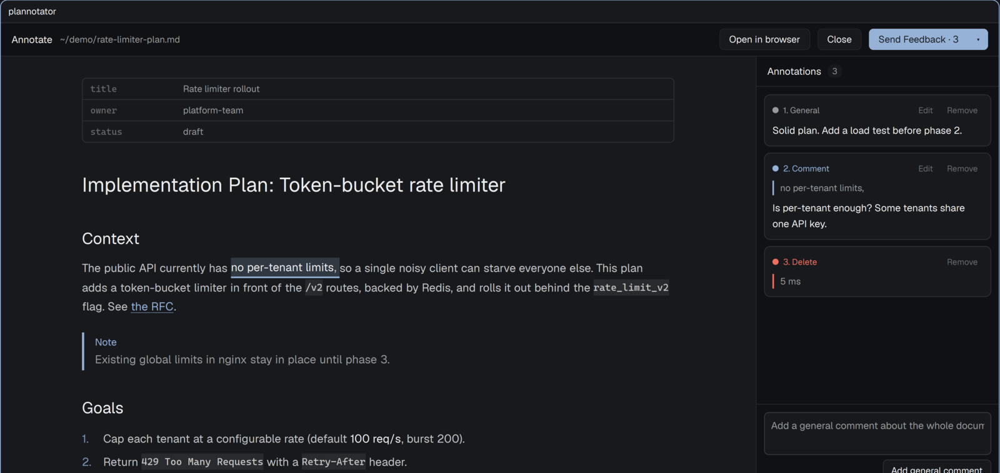

# Plannotator

Review [Plannotator](https://github.com/backnotprop/plannotator) sessions in a
pane beside your agent instead of a browser tab. Plan reviews, annotated
Markdown files and code reviews open natively: select text to comment or
delete, comment on diff lines, then approve or send feedback. The agent gets
the same feedback the browser would have sent.

## What you see

A pane (or tab) named `plannotator`, opened beside the terminal that started
the session.

- **Header**, 44 px, `chrome` background. The mode title in 13 px semibold
  ("Plan review", "Annotate", "Code review"), then the file or diff in 12 px
  `muted`, with paths under home shortened to `~/`. On the right: **Open in
  browser**, **Close** (annotate and review only), and the decision control.
  The decision control is a primary button with a ▾ caret. It reads
  "Approve" or "Done" with no notes and "Send Feedback · n" with n notes.
  The caret opens Plannotator's own menu: "Send with a note…", "Approve with
  notes", "Approve, discard n annotations…" and the rest, with their note
  composer and confirm steps.
- **Document view** (plan review, annotate). The rendered Markdown in a
  centered column: headings, paragraphs, lists with ✓/○ tasks, blockquotes
  and GitHub alerts, code blocks in the terminal font, tables, frontmatter as
  a small key/value card. Comments show as an accent tint with an underline,
  deletions as a red tint with strikethrough. On the right, an
  **Annotations** panel lists general comments, then the rest in document
  order, each with Edit and Remove, and a general comment box at the bottom.
- **Review view** (code review). A toolbar with the diff-type picker, file
  count, +/− totals, "n/m viewed", General comment and Show comments. A
  file list with viewed checkboxes, A/D/R/M status, comment counts and
  +/− counts. A unified diff with old and new line numbers and add/remove
  tints (`ansi2`/`ansi1`). Comments show as cards under their last line.
- **Done**: a one-line result ("Feedback sent to the agent.") and the pane
  closes itself after 2 s. If the session ends elsewhere, the pane says so.

## How it behaves

- `plannotator-herdr annotate plan.md` (same arguments as `plannotator`)
  starts Plannotator with this pane as its browser. The pane splits right of
  the agent's terminal (`HC_TERMINAL_ID`), or opens as a tab
  (`PLANNOTATOR_HERDR_PLACE=down|tab`). Without a herdr window it opens the
  browser.
- Setting `PLANNOTATOR_BROWSER=<path to plannotator-herdr>` sends every
  session there, ExitPlanMode plan review included.
- Drag across words to select. A toolbar offers Comment and Delete.
  Double-click selects a word. Code lines and table cells select as units.
  Ctrl+Enter saves a comment, Esc cancels.
- In a diff, click a line to comment, shift-click to extend; j/k switch files.
- Annotations autosave as Plannotator drafts, so a reopened session restores
  them.
- Sessions the pane can't draw (folders, bundles, raw HTML, live apps, the
  archive) show a notice. **Open in browser** opens the same session in the
  web UI for those and for Ask AI, tours, images and settings.
- No agent status colors: this mod is a review surface, not an agent list.

## Built from

- **Mod** `mods/plannotator/`, `mod.json` `{ "place": "none" }`: it appears
  only where the launcher puts it. Props: `{ url, version }`, the session
  origin and the running CLI version.
  - `main.js`: loads the session (`GET /api/plan`, else `/api/diff`), picks
    the view, owns drafts, decisions and the header. A root task awaiting a
    shared promise redraws the header when a child view changes.
  - `decision.js`: renders upstream's `DecisionSpec` with `Popover`,
    `Textarea`/`TextareaState`.
  - `doc/`: word tokens in `flex_wrap` rows, one retained child view per
    block; selection with `on_mouse_down`/`on_mouse_move`/`on_mouse_up`.
  - `review/`: its own unified-diff parser, `v_virtual_list` for the diff.
  - `vendor/plannotator.js`: Plannotator's export, decision-spec and request
    code, bundled by `tools/update-vendor.sh` from the installed CLI's
    release tag (`PINNED_VERSION`). Licensed MIT or Apache-2.0, notices in
    `vendor/`.
- **herdr**: `props`, `focused`, `run("pane.close")`, `theme`, `home`,
  `fetch`, `cx.open_url`, `cx.timer`.
- **Launcher** `bin/plannotator-herdr` (POSIX sh, needs `jq`):
  `herdr-app ls`, `herdr-app do pane.split|tab.new --mod plannotator`.

## Watch out

- The mod reaches the network: it fetches the local Plannotator session URL
  it was given, and **Open in browser** opens that URL. It reads no files.
  It runs a program only for the test-only `dump` prop/step, which writes the
  annotations to a path with `sh`; normal use never sets it.
- The launcher runs programs: `plannotator`, `herdr-app`, `jq`, and
  `xdg-open` as the fallback.
- `herdr-app check` blocks `fetch`, so it only proves the first render.
  Prove network paths in the live app.
- `TextView` can't report a selection, which is why the document is word
  tokens. A mouse release outside the pane leaves the drag active until the
  next press.
- Plannotator updates itself. Request bodies follow the vendored version;
  after an update the header shows "Plannotator X · pane built for Y" until
  the bundle is rebuilt.
- Browser-only settings take the web's first-run defaults: Claude Code plan
  approval sends `permissionMode: acceptEdits`.
- A plan revised while the pane is open gets an error toast; the browser
  reloads instead.

## Done when

- `herdr-app check mods/plannotator` passes.
- `plannotator-herdr annotate some.md` opens the pane beside the terminal,
  rendered, with "Done ▾" in the header.
- Selecting words and adding a comment turns the button into
  "Send Feedback · 1"; sending prints `# File Feedback` with that quote and
  comment on the CLI, and the pane closes.
- Piping an ExitPlanMode hook payload through `plannotator` with
  `PLANNOTATOR_BROWSER` set opens "Plan review" with Approve; Approve makes
  the hook print `"behavior":"allow"`.
- `plannotator-herdr review` in a repo with changes lists the files; a line
  comment sent shows as `### Line N (new)` in the CLI output.
- `tests/pane-e2e.sh` prints `all pane e2e cases passed`.
